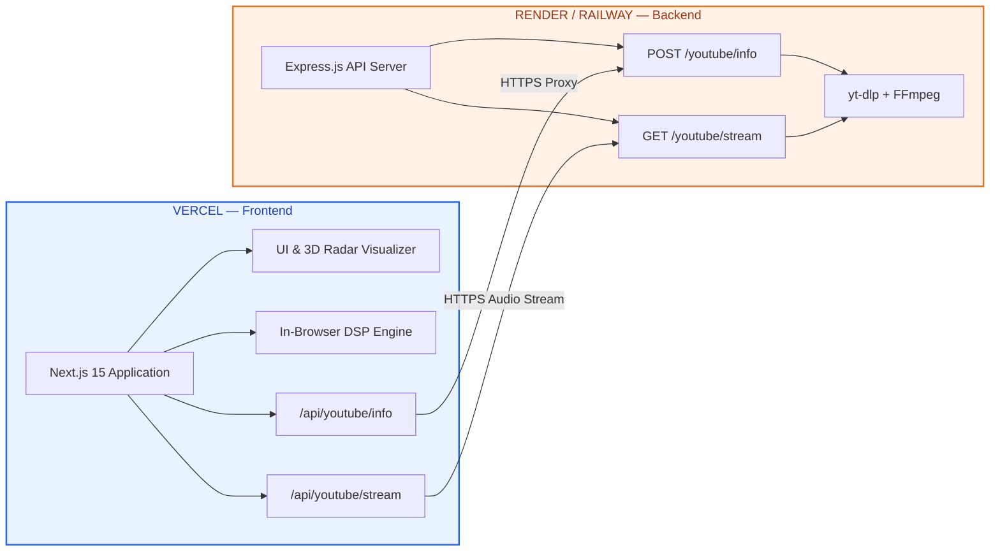
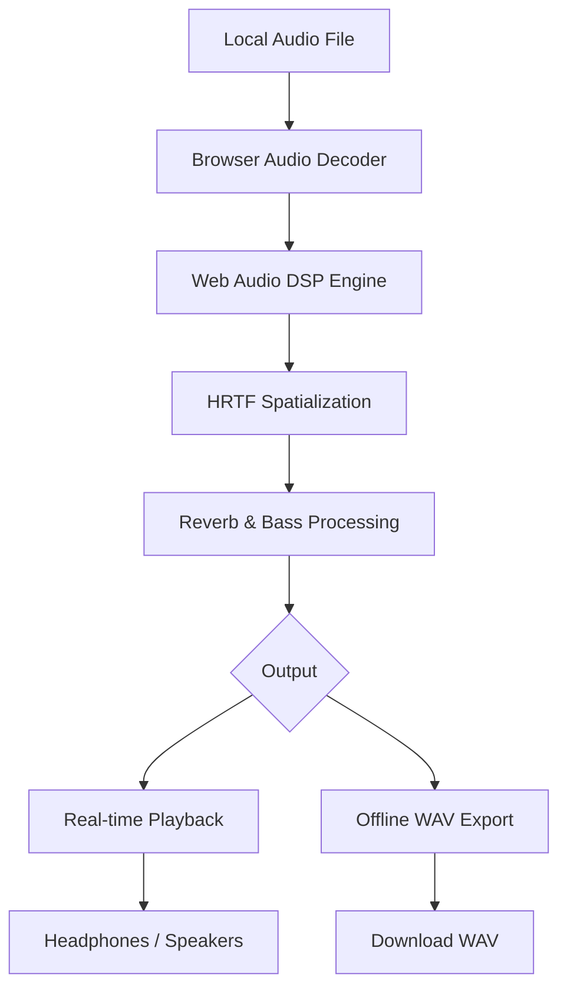
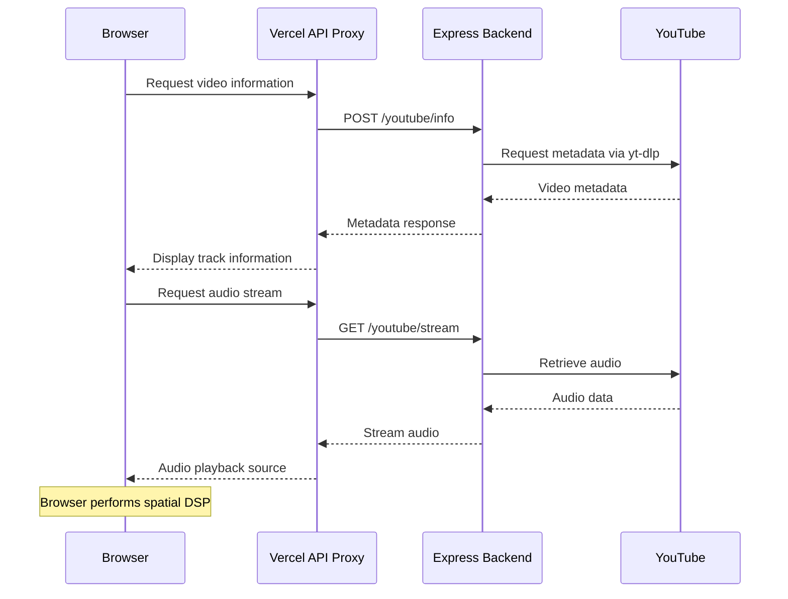

<div align="center">

# 🎧 Sphere8D

### Spatial Music Studio & 8D Audio Player

**Transform ordinary music into an immersive 360° spatial audio experience.**

Real-time binaural rotation • HRTF spatialization • Concert reverb • Deep bass enhancement

[](https://sphere8d.vercel.app)
[](https://github.com/TheCodePrism/8d-audio-converter)
[](LICENSE)

<br />


**[🚀 Launch Sphere8D](https://sphere8d.vercel.app)** · **[⚙️ Installation](#-quick-start)** · **[🏛️ Architecture](#-system-architecture)**

</div>

---

## 🌌 Overview

**Sphere8D** is a browser-based spatial audio studio that transforms standard stereo and mono audio into immersive **8D listening experiences**.

Powered by the **Web Audio API**, Sphere8D combines HRTF binaural spatialization, dynamic 360° sound rotation, acoustic reverberation, and enhanced low-frequency processing.

The integrated music player provides an interactive **3D radar visualizer**, animated vinyl record, real-time playback controls, and instant switching between original stereo and processed spatial audio.

All DSP processing runs directly in your browser. An optional standalone backend provides YouTube audio import through `yt-dlp` and FFmpeg.

### Highlights

- 🎧 **360° Spatial Audio** — Dynamic sound positioning using HRTF binaural processing.
- 🌀 **Live Radar Visualization** — Real-time tracking of audio rotation and channel balance.
- 🎛️ **Professional DSP Controls** — Fine-tune spatial motion, reverberation, and bass.
- 🎵 **Integrated Music Player** — A fully featured deck with an animated vinyl interface.
- 🔄 **Instant A/B Comparison** — Switch between original stereo and 8D audio.
- 📥 **Flexible Audio Import** — Local audio files, YouTube links, and playlists.
- 🎹 **Built-in Demo Synthesizer** — Generate audio directly inside the browser.
- 💾 **WAV Export** — Download processed audio as 16-bit PCM WAV files.
- 🔒 **Privacy-First** — Local audio files remain on your device.

---

## ✨ Key Features

### 🎵 1. Spatial Music Player Deck

A modern music player designed for immersive listening and real-time audio visualization.

#### 360° HRTF Radar HUD

An animated Canvas-based visualizer showing:

- Real-time azimuth coordinates from **0° to 360°**
- Circular sound-source positioning
- Left/right ear balance meters
- Acoustic ripple animations synchronized with playback
- Dynamic visualization of spatial movement

#### Animated Vinyl Record

- Realistic spinning vinyl animation
- Album artwork integration
- Dynamic rotation based on playback state
- Responsive visual feedback

#### Instant A/B Spatial Switch

Seamlessly compare:

| Mode | Description |
|------|-------------|
| **8D Spatial** | HRTF-based rotating audio with spatial effects |
| **Original Stereo** | Unprocessed original audio playback |

Switch between modes without losing playback progress.

#### Full Playback Controls

- Play / Pause
- Previous / Next track
- Rewind 10 seconds
- Forward 10 seconds
- Shuffle playback
- Repeat / Loop
- Interactive progress bar
- Volume adjustment
- One-click Mute / Unmute

---

### 🎛️ 2. 8D Spatial Audio Engine

Sphere8D includes a browser-native digital signal processing engine built using the **Web Audio API**.

#### 🌀 HRTF Binaural Spatialization

Uses the Web Audio API's `PannerNode` configured with:

```typescript
panner.panningModel = "HRTF";
```

HRTF (Head-Related Transfer Function) processing approximates the way sound reaches the listener's ears.

This includes spatial cues such as:

- **ITD** — Interaural Time Difference
- **ILD** — Interaural Level Difference
- Direction-dependent acoustic filtering
- Dynamic sound-source positioning

The sound source rotates around the listener to create a 360° spatial listening effect.

#### 🏛️ Concert Room Reverberation

Simulates a spacious acoustic environment through:

- Synthetic stereo impulse response
- Early reflection modeling
- Diffuse reverberation decay
- Parallel dry/wet gain routing
- Adjustable reverberation intensity

Implemented with `ConvolverNode` and gain controls.

#### 🔊 Sub-Bass Enhancement

A `BiquadFilterNode` configured as a `lowshelf` filter enhances low frequencies.

**Specifications:**

| Parameter | Value |
|-----------|-------|
| Filter Type | Low-shelf |
| Frequency Range | 20–160 Hz |
| Maximum Boost | +12 dB |
| Processing | Real-time |

#### 🎚️ Audio Presets

Four presets provide different spatial listening experiences.

| Preset | Orbit | Direction | Sound Character |
|--------|-------|-----------|-----------------|
| 🎧 **Classic 8D** | 12 seconds | Clockwise | Balanced spatial audio with natural room reverb |
| 🌌 **Slow Ambient** | 20 seconds | Clockwise | Relaxed movement with concert-hall ambience |
| ⚡ **Fast & Dynamic** | 7 seconds | Clockwise | Energetic rotation with punchy bass |
| 🔥 **Deep Bass Orbit** | 10 seconds | Counter-clockwise | Heavy bass with +8 dB emphasis |

---

### 📥 3. Flexible Music Importer & Queue

Sphere8D supports multiple ways to import and process audio.

#### Local Audio Upload

Import files directly from your device using drag-and-drop.

**Supported formats:**

- MP3
- WAV
- OGG
- M4A
- FLAC

**Maximum file size:** 50 MB

Audio decoding and processing are performed locally in the browser.

> Actual format compatibility depends on the browser's supported audio codecs.

#### YouTube URL & Playlist Import

Import music using a YouTube video or playlist URL.

The optional backend uses:

- `yt-dlp` for retrieving media information and streams
- `FFmpeg` for audio processing
- Express.js for API endpoints
- Docker for containerized deployment

YouTube audio is delivered through the Next.js API proxy.

> **Note:** YouTube functionality depends on the availability of the backend, upstream service compatibility, and applicable content permissions and platform terms.

#### ✨ Instant Demo Synthesizer

Test the spatial audio engine without uploading any music.

The built-in Web Audio API synthesizer generates an ambient synthwave demo track directly inside the browser.

**Features:**

- Near-instant audio generation
- Stereo synthesizer output
- No external media required
- Ideal for testing DSP settings and presets

#### Track Queue Manager

Manage multiple audio tracks from one interface.

- Add and remove tracks
- Select tracks for playback
- Manage playback order
- Batch convert audio
- Re-convert with updated DSP settings
- Export processed audio as WAV

**Export format:** 16-bit PCM WAV

---

### 🔒 4. Privacy-First Audio Processing

Sphere8D performs its audio DSP processing entirely inside the browser.

Local files are not uploaded to the backend for conversion.

**Client-side operations include:**

- Audio decoding
- HRTF spatial processing
- Reverb processing
- Bass enhancement
- Offline audio rendering
- WAV encoding

Offline conversion uses `OfflineAudioContext`.

**Local audio files remain on your device.**

YouTube imports are handled separately through the optional backend service and require network requests.

---

## 🏛️ System Architecture

Sphere8D uses a decoupled architecture separating the frontend application from the optional YouTube media backend.

### Architecture Diagram



### Architecture Components

| Layer | Technology | Hosting | Responsibility |
|-------|------------|---------|----------------|
| Frontend | Next.js 15 / React 19 | Vercel | UI and music player |
| Visualization | Canvas / JavaScript | Browser | Radar HUD and visual effects |
| DSP Engine | Web Audio API | Browser | Spatial audio processing |
| API Proxy | Next.js API Routes | Vercel | Forward YouTube requests |
| Backend | Node.js / Express | Render / Railway | YouTube API handling |
| Media Engine | yt-dlp / FFmpeg | Linux Docker | Media extraction and streaming |

### Audio Processing Flow

For local audio files:



For YouTube audio:



---

## 🚀 Quick Start

### Prerequisites

Install the following tools:

- [Node.js](https://nodejs.org/) — Version 20 or 22
- [Git](https://git-scm.com/)
- npm — Included with Node.js

### 1. Clone the Repository

```bash
git clone https://github.com/TheCodePrism/8d-audio-converter.git
cd 8d-audio-converter
```

### 2. Install Dependencies

```bash
npm install
```

### 3. Start the Development Server

```bash
npm run dev
```

### 4. Open Sphere8D

Visit:

**http://localhost:3000**

The frontend is ready for local audio playback, DSP processing, and visualization.

> The YouTube importer requires the optional backend service described below.

---

## 📦 Backend Setup

The standalone backend enables YouTube video and playlist imports.

It runs as a Node.js Express application with `yt-dlp` and FFmpeg support.

### Running the Backend Locally

Navigate to the backend directory:

```bash
cd backend
```

Install dependencies:

```bash
npm install
```

Start the backend:

```bash
node server.js
```

The backend runs at:

```text
http://localhost:3001
```

### Configure the Frontend

Create a `.env.local` file in the project root directory:

```env
YOUTUBE_BACKEND_URL=http://localhost:3001
```

Restart the Next.js development server after changing environment variables.

### Backend API Endpoints

| Method | Endpoint | Description |
|--------|----------|-------------|
| `POST` | `/youtube/info` | Retrieve YouTube video metadata |
| `GET` | `/youtube/stream` | Stream YouTube audio |

The Next.js frontend accesses these endpoints through its own API routes:

| Frontend Route | Backend Route |
|----------------|---------------|
| `/api/youtube/info` | `/youtube/info` |
| `/api/youtube/stream` | `/youtube/stream` |

---

## 🌐 Production Deployment

Sphere8D supports separate frontend and backend deployments.

### Option A: Deploy Frontend to Vercel

1. Sign in to [Vercel](https://vercel.com).
2. Select **Add New Project**.
3. Import the GitHub repository.
4. Configure the project to use **Node.js 22.x**.
5. Add the environment variable:

```env
YOUTUBE_BACKEND_URL=https://your-backend.onrender.com
```

6. Click **Deploy**.

Your frontend will be accessible through the URL assigned by Vercel.

**Live Application:** https://sphere8d.vercel.app

### Option B: Deploy Backend to Render

1. Sign in to [Render](https://render.com).
2. Select **New → Web Service**.
3. Connect the GitHub repository.
4. Configure the service:

| Setting | Value |
|---------|-------|
| Root Directory | `backend` |
| Runtime | Docker |
| Instance Type | Free, if available |
| Deployment | Automatic or manual |

5. Create the Web Service.
6. Copy the public backend URL.
7. Add the URL to the Vercel environment variable `YOUTUBE_BACKEND_URL`.
8. Redeploy the frontend.

> Render plan availability and pricing may change. Use a plan that supports the application's memory, CPU, and streaming requirements.

### Alternative: Railway

The backend can also be deployed on [Railway](https://railway.com) using the same Docker configuration.

Make sure the service:

- Runs the Express application
- Includes `yt-dlp` and FFmpeg
- Exposes the application port
- Provides a public HTTPS endpoint
- Has sufficient resources for audio streaming

Configure Vercel with the Railway backend URL.

---

## 🛠️ Technology Stack

| Category | Technologies |
|----------|-------------|
| **Frontend Framework** | Next.js 15 (App Router), React 19, TypeScript |
| **Styling** | Tailwind CSS, Radix UI, Lucide Icons |
| **Audio Processing** | Web Audio API |
| **Spatial Audio** | `PannerNode` with HRTF |
| **Reverberation** | `ConvolverNode`, `GainNode` |
| **Bass Processing** | `BiquadFilterNode` |
| **Offline Rendering** | `OfflineAudioContext` |
| **Visualization** | HTML Canvas |
| **Backend Service** | Node.js, Express |
| **Media Processing** | `yt-dlp`, FFmpeg |
| **Containerization** | Docker |
| **Frontend Hosting** | Vercel |
| **Backend Hosting** | Render / Railway |

---

## 🎧 Best Practices for Listening

### Use Headphones

For the best experience, use **stereo headphones or earbuds**.

Binaural spatial audio relies on different acoustic signals reaching the left and right ears.

Headphones preserve this separation and improve the perceived direction and motion of sound.

External speakers can reproduce the audio, but room acoustics and acoustic channel mixing may reduce the spatial effect.

### Listening Recommendations

1. **Use headphones** for the most immersive experience.
2. **Start at a moderate volume** and increase gradually if needed.
3. **Try Classic 8D first** for a balanced introduction.
4. **Compare Stereo and 8D modes** to hear the spatial differences.
5. **Experiment with presets** to discover different sound environments.
6. **Avoid excessive bass boost**, especially at high volume levels.

---

## 🔐 Privacy & Security

Sphere8D is designed to keep local audio processing within the browser.

| Operation | Processing Location |
|-----------|---------------------|
| Local file upload and decoding | Browser |
| HRTF spatialization | Browser |
| Bass enhancement | Browser |
| Reverberation | Browser |
| WAV conversion | Browser |
| Local audio playback | Browser |
| YouTube metadata retrieval | Backend |
| YouTube audio streaming | Backend |

Local files are not sent to the backend for DSP processing.

Network requests are required when importing audio from YouTube.

---

## 🤝 Contributing

Contributions, improvements, and feature suggestions are welcome.

To contribute:

1. Fork the repository.
2. Create a new feature branch.

```bash
git checkout -b feature/your-feature
```

3. Make your changes.
4. Commit your changes.

```bash
git commit -m "Add new feature"
```

5. Push the branch.

```bash
git push origin feature/your-feature
```

6. Open a Pull Request.

For bugs and feature requests, use the repository's [GitHub Issues](https://github.com/TheCodePrism/8d-audio-converter/issues).

---

## 📄 License

This project is licensed under the **MIT License**.

See the [LICENSE](LICENSE) file for details.

---

<div align="center">

### 🎧 Experience Music in a New Dimension

**360° Spatial Sound. Real-Time Processing. Pure Immersion.**

[**🚀 Launch Sphere8D**](https://sphere8d.vercel.app)

Made with ❤️ for immersive audio.

</div>
